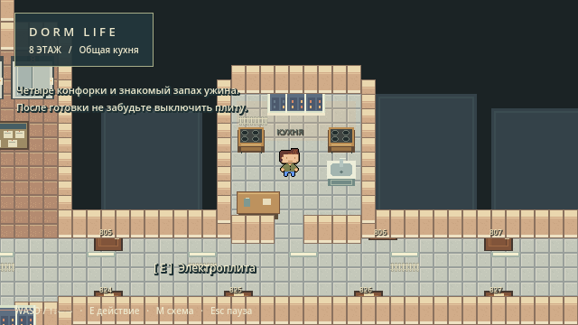

# Dorm Life — восьмой этаж

Игровой прототип общежития на Godot 4.3, созданный на основе ForlornU/TopdownStarter. Исследуйте четыре крыла этажа, кухни, холл, две лифтовые, аудиторию, лестничную клетку и лоджию.



## Копия из GitHub

Клонируйте репозиторий или скачайте ZIP, импортируйте `project.godot` в Godot 4.3 и нажмите F5. Движок в Git не хранится; его можно скачать с https://godotengine.org/download/archive/4.3-stable/.
Пользовательские фотографии и схема также остаются локальными: для игры они не требуются. GitHub Actions настроен для импорта и игровых проверок при push и pull request; первый удалённый запуск будет доступен после загрузки репозитория.

## Запуск

**Windows:** дважды нажмите `Start Game.cmd`. Рядом с папкой DormLife должна находиться папка Godot4.3 с комплектным официальным движком. При первом запуске импорт ресурсов может занять некоторое время.

**Через редактор:** запустите `../Godot4.3/Godot_v4.3-stable_win64.exe`, импортируйте `project.godot`, откройте проект и нажмите F6 для открытой сцены DormFloor08 или F5 для запуска проекта. Уже установленный Godot 4.3 также подходит. Новые версии 4.x отдельно не проверены.

Архив DormLife-source.zip содержит исходники без движка и без кэша .godot. Для него нужен установленный Godot 4.3 или комплектная соседняя папка Godot4.3.

## Управление

- WASD / стрелки — движение.
- E — ближайший доступный объект; подсказка появляется внизу экрана.
- M — схема этажа с положением игрока.
- Esc — пауза, закрытие лифта или схемы.
- Крестик окна — выход.

## Что реализовано

- Геометрия по пользовательскому Draw.io: 46 исходных элементов, четыре крыла, четыре кухни, холл, две лифтовые зоны, лоджия, аудитория, лестница и оконные торцы.
- Исходные спрайты, Walk/Idle-анимации, анимационная библиотека и FSM персонажа. Скорость 140; физическое движение и плавное сопровождение камеры со скоростью сглаживания 15.
- Новые повторяющиеся текстуры 16×16 и пиксельная мебель: плиты, раковины, столы, окна, радиаторы, сушилки, объявления и лифты.
- Двери с переключением коллизии, закрытые блоки с номерами, осмотр плиты/объявлений/окна. Двери не закрываются на игроке.
- Панель лифта с текущим этажом 8 и недоступными остальными этажами, сообщение лестницы о будущем переходе.
- Русский интерфейс, схема, пауза, тихие синтезированные звуки.

## Основные файлы

- `Scenes/Levels/DormFloor08.tscn` — главная сцена.
- `Scripts/Dorm/FloorManager.gd` — карта, оформление, мебель, UI и звук.
- `Scripts/Dorm/DormPlayer.gd` — адаптер исходного Player.
- `Scripts/Dorm/Interactable.gd`, `InteractionManager.gd` — действия и выбор объекта.
- `Data/Floors/floor08.json` — редактируемые прямоугольники зон и точка появления.
- `Art/Dorm` — новые PNG.
- `references` — исходные пользовательские материалы.

Редактирование масштаба, геометрии и добавление следующего этажа описаны в `docs/floor_layout.md`. Допущения — `docs/assumptions.md`, лицензии — `docs/asset_licenses.md`.

## Проверки

`Scripts/Dorm/Verify.gd` запускает игровую сцену и проверяет движение, исходные анимации, физические столкновения со стеной и кухонной дверью, открывание и закрывание дверей, выбор действия через луч, панель лифта и доступность каждой общественной зоны с учётом мебели. Запуск:

```text
Godot_v4.3-stable_win64_console.exe --headless --path ПУТЬ_К_DormLife --script res://Scripts/Dorm/Verify.gd
```

Без `--headless` дополнительно сохраняются реальные кадры рендера в `docs/preview_*.png`. Отчёт выполненной проверки: `docs/verification.txt`. Это автоматизированные проверки, не полный ручной проход человеком.

## Ограничения

Это первый MVP: закрытые комнаты без интерьеров, условная нумерация, упрощённые материалы и вечерний свет. Нет NPC, квестов, сохранения на диск и переходов на другие этажи. Размеры требуют пользовательской сверки. Исходные демонстрационные сцены TopdownStarter сохранены, но при Play запускается общежитие.

Следующий этап — сверить пропорции с реальным этажом и доработать настенные поверхности, стыки дверей и художественные детали. Подробности в документации.

Основа: https://github.com/ForlornU/TopdownStarter. MIT и уведомления о ресурсах сохранены.
