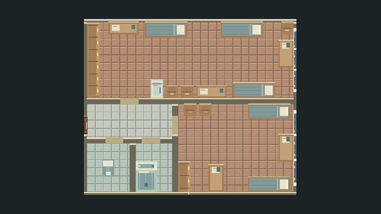

# Исправленный интерьер блока 812

Дата: 1 ноября 2026. Godot 4.3 stable. Рабочая ветка: `codex/block813-interior-balconies`. Существующие незакоммиченные изменения сохранены; публикация и коммит не выполнялись.

| Номер | zone.id | Фасад | Доступ |
|---|---|---|---|
|812|54|[512,384,112,160]|Открыт, отдельная сцена Block812|
|813|38|[304,544,160,112]|Закрыт|
|818|42|[64,944,160,112]|Закрыт|

Источники истины: номера, фасады и `accessible` — `Data/Floors/floor08.json`; маршрут — `DormTransition.BLOCK_SCENES`; внутренняя планировка — `Data/Interiors/block812.json`. Нумерация и фасады других блоков сохранены. Проверка доступности есть как при создании двери, так и при переходе. Старый маршрут с запасным переходом в 813 удалён.

## Изменения геометрии

- Западная стена возле входа в Б: 126 → 66 px (сокращение 47,6%). Толщина 12 px сохранена. Проём шириной 36 px сдвинут на 60 px влево.
- Правая комната А, дверь, мебель, восточная стена и оба окна сдвинуты влево на 60 px. Оболочка 480×348 → 420×348; площадь меньше на 12,5%. Комната А остаётся 228×174 px.
- Туалет 84×96 и душевая 72×96 px. Между душем и правой перегородкой проход 30 px, при диаметре коллизии персонажа 16,12452 px. Размеры санитарных предметов сохранены.
- Унитаз: центр визуального и физического прямоугольника `(60,306)` совпадает с геометрическим центром туалета. Ориентация сохранена.
- Верхняя правая кровать Б: x=252 → 282; зазор до окна 150 → 60 px с учётом сдвига восточной стены. До тумбочки остаётся 36 px. Проверен связный маршрут от выхода до её южного фасада.
- Визуальные стены и физические тела создаются из одних прямоугольников; мебель использует общий размер для рисунка и коллизии. Старых препятствий в сцене 812 нет.

## Проверка

Команды из корня проекта (путь к установленному движку может отличаться):

```powershell
& '../Godot4.3/Godot_v4.3-stable_win64_console.exe' --headless --path . --script res://Scripts/Dorm/Verify.gd
& '../Godot4.3/Godot_v4.3-stable_win64_console.exe' --path . --script res://Scripts/Dorm/Verify.gd
```

- Без рендера: **2836 проверок, 0 ошибок** (`verify_block812_headless.log`).
- С рендером: **2912 проверок, 0 ошибок** (`verify_block812_render.log`).
- Проверены E у настоящей двери 812, единственный активный маршрут, блокировка 813/818 через E и прямой вызов перехода, отклонение неизвестного номера, два цикла входа/выхода, сохранение позиции и направления возврата.
- Реальная физика проверяет закрытые/открытые двери, запрет закрывания на персонаже, периметры, пересечения мебели/стен, проходимость всех помещений и подходы ко всем предметам, включая южный фасад тумбочки. Размер и FSM исходного персонажа сохранены.
- Сохранены реальные кадры `preview_812_*.png`; общий кадр просмотрен визуально. Это автоматизированный проход, ручное управление человеком не заявляется.



## Допущение по референсам

В приложении к текущему запросу есть только текст. Два упомянутых игровых скриншота отсутствуют; текст обрывается в разделе 10. Изучены прежняя схема и текущие данные интерьера 818. Выбор западного участка стены и верхней правой кровати Б является допущением. Точное совпадение с отсутствующими скриншотами не подтверждено. Старые сцены и JSON 813/818 оставлены как исходные материалы, игровые маршруты к ним закрыты.
