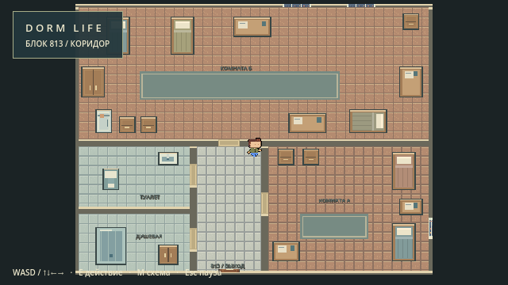

# Блок 813 и наружные балконы

> Исходный отчёт до уменьшения интерьера. Актуальные размеры, радиаторы и проверки: [compact813_report.md](compact813_report.md).

Дата: 1 ноября 2026. Движок: Godot 4.3 stable official 77dcf97d8, Windows, OpenGL compatibility.
Ветка: `codex/block813-interior-balconies`, основана на актуальной рабочей ветке с исправлениями ориентации и нумерации (`1177758`). Перед началом выполнен `git fetch origin`; рабочее дерево было чистым.

## Нумерация и доступ

**813 = техническая зона `38`**, прямоугольник `[304,544,160,112]` в `Data/Floors/floor08.json`. Это существующее соответствие маршрута 800–826, оно не изменялось. Блок 800 остаётся зоной `36` напротив северной лестницы. Только дверь номера 813 получает действие `block_entry`; все остальные 26 жилых блоков сохраняют физическую преграду и сообщение «Комната закрыта». Интерьер отсутствует в дереве сцены этажа.

До 813: от центрального холла двигаться на юг, первая жилая дверь справа в коридоре (напротив 819). E — войти. Внутри входная дверь снизу центрального коридора возвращает на этаж.

## Интерьер

`Scenes/Rooms/Block813.tscn` — самостоятельная сцена с оболочкой 800×608 пикселей. Большая комната Б сверху, меньшая А справа снизу, коридор в центре снизу; туалет и душевая слева, разделены физической перегородкой. Четыре внутренние двери открываются и закрываются через E с защитой от закрывания на игроке.

Всего 21 физический предмет: 5 кроватей, 5 столов, 5 тумбочек, холодильник, шкаф комнаты Б, хозяйственный шкаф, унитаз, раковина, душевой поддон/кабина. Сохранены описанные количества и расположение мебели; центральные проходы свободны. Пол, двери и окна используют существующие текстуры, мебель рисуется кодом по целочисленной пиксельной сетке, со спокойной палитрой, подушками, бельём, ручками и поверхностями. Все крупные предметы имеют коллизию своего размера. Мебель и персонаж находятся в одном Y-sorted контейнере.

Отдельного чертежа интерьера во вложении и в `references` нет. Планировка выполнена по текстовому описанию задания; точное совпадение с отсутствующим эскизом не заявляется.

## Смена сцен, управление и камера

Autoload `DormTransition` вызывает `SceneTree.change_scene_to_file` отложенно, освобождая предыдущую сцену. Он сохраняет безопасную точку непосредственно перед дверью 813 со стороны коридора и направление персонажа, блокирует повторную смену сцены до завершения перехода. Возврат и повторный вход проверены двумя циклами.

Обе сцены используют исходный `Player.tscn`, `DormPlayer`, Idle/Walk FSM, общий код создания игрока, взаимодействий, интерфейса, паузы и звука. Отдельной системы движения нет. Внутри сохранены WASD, стрелки, E, Esc, M. Камера плавная, ограничена оболочкой интерьера; при изменении соотношения сторон целочисленный zoom удерживает видимую область внутри оболочки. На этаже восстанавливаются его камера и ограничения. Состояние мебели/дверей при повторном входе сбрасывается: сохранение на диск не добавлялось.

## Мебель для будущего расширения

`Scenes/Furniture/Furniture.tscn` и `Scripts/Dorm/Furniture.gd` — общий переиспользуемый физический компонент. Экспортируются `object_id`, `furniture_kind`, `footprint`, `tint`, `opened`. Шкафы, тумбочки и холодильник имеют стабильные уникальные ID с префиксом `813_`. Состояние `opened` подготовлено, но механика открывания мебели, содержимое, инвентарь и окна хранения отсутствуют.

## Балконы

Зоны 22/13/9/6 сохраняют наружные направления север/юг/запад/восток. На наружных гранях вместо стен нарисованы стальные перила с прежними физическими границами. Серо-голубой бетонный пол отличается от коридоров. Под геометрией рисуется вечерний фон с силуэтами зданий и освещёнными окнами, тенью выступающей плиты; фон не имеет коллизий и не перекрывает игрока.

Зона 4 остаётся выходом к пожарной лестнице: наружные ступени/перекладины и отдельная подсказка «Пожарная лестница»; спуск закрыт. Центральная лоджия 28 сохраняет внутреннее оформление. Геометрия, входы, окна, лифты и JSON-нумерация не менялись.

## Проверки

- Импорт проекта в официальном Godot 4.3: успешно.
- `--headless --path . --script Scripts/Dorm/Verify.gd`: **1969 проверок, 0 ошибок**. Лог: [verify_block813_headless.log](verify_block813_headless.log).
- `--path . --script Scripts/Dorm/Verify.gd` с настоящим OpenGL-рендером: **2010 проверок, 0 ошибок**. Лог: [verify_block813_render.log](verify_block813_render.log).
- Существующие проверки геометрии, нумерации, лифтов, стен, окон, всех общественных зон и физических границ балконов сохранены.
- Добавлены реальный E-вход и выход со сменой сцены, повторный вход, точка и направление возврата, отсутствие второго игрока, активная камера, безопасный spawn, E для четырёх внутренних дверей, поиск маршрутов с реальной формой коллизии и `CharacterBody2D.test_move`, пять доступных помещений, точные коллизии и непересечение всех предметов, количество мебели, пауза, движение и анимации.
- В графическом запуске дополнительно проверяется видимость игрока возле окон сравнением реальных кадров. Скриншоты всех перечисленных ниже помещений и балконов просмотрены визуально; проход человеком по всем маршрутам отдельно не проводился.
- Итоговые логи не содержат SCRIPT ERROR, ERROR, FAIL или предупреждений об утечках. `git diff --check` пройден.

Примеры команд PowerShell из корня проекта:

```powershell
& ..\Godot4.3\Godot_v4.3-stable_win64_console.exe --headless --path . --editor --import --quit
& ..\Godot4.3\Godot_v4.3-stable_win64_console.exe --headless --path . --script Scripts/Dorm/Verify.gd
& ..\Godot4.3\Godot_v4.3-stable_win64_console.exe --path . --script Scripts/Dorm/Verify.gd
```

## Реальные кадры

Обзорный кадр использует временно уменьшенный zoom только в тесте, чтобы показать весь план; обычная игровая камера имеет zoom 1.



- [Вход 813](preview_813_entrance.png)
- [Комната Б](preview_813_room_b.png)
- [Комната А](preview_813_room_a.png)
- [Коридор](preview_813_corridor.png)
- [Туалет](preview_813_toilet.png)
- [Душевая](preview_813_shower.png)
- Балконы: [север 22](preview_balcony_22.png), [юг 13](preview_balcony_13.png), [запад 9](preview_balcony_9.png), [восток 6](preview_balcony_6.png), [пожарный выход 4](preview_balcony_4.png).

## Изменённые файлы

Исходники и документация:

- `project.godot`
- `README.md`
- `Scripts/Dorm/FloorManager.gd`
- `Scripts/Dorm/DormPlayer.gd`
- `Scripts/Dorm/Verify.gd`
- `Scripts/Dorm/DormTransition.gd` (новый)
- `Scripts/Dorm/Block813.gd` (новый)
- `Scripts/Dorm/Furniture.gd` (новый)
- `Scenes/Rooms/Block813.tscn` (новый)
- `Scenes/Furniture/Furniture.tscn` (новый)
- `docs/block813_report.md` (этот отчёт)

Артефакты:

- `docs/verify_block813_headless.log`, `docs/verify_block813_render.log`
- `docs/preview_813_entrance.png`, `preview_813_overview.png`, `preview_813_room_a.png`, `preview_813_room_b.png`, `preview_813_corridor.png`, `preview_813_toilet.png`, `preview_813_shower.png` (все в `docs/`)
- `docs/preview_balcony_4.png`, `preview_balcony_6.png`, `preview_balcony_9.png`, `preview_balcony_13.png`, `preview_balcony_22.png`
- `docs/preview_window_4.png`, `preview_window_6.png`, `preview_window_9.png`, `preview_window_13.png`, `preview_window_22.png`

PR не создан, ветка не отправлялась на сервер, main не изменён и автоматического слияния нет.
