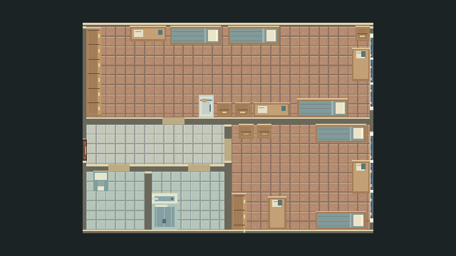

# Блок 818 — реализация по пользовательской схеме

Дата: 1 ноября 2026. Godot 4.3 stable official 77dcf97d8, Windows, OpenGL compatibility.

## Результат и исходное состояние

В рабочей копии уже существовал незакоммиченный интерьер 813. У 818 интерьера не было: его дверь была закрыта. Проверено соответствие **818 = zone.id 42**, фасад `[64,944,160,112]`. Для 818 создана отдельная сцена; внешняя геометрия JSON, коридоры, холл, лифты и интерьер 813 сохранены. Изменения внесены поверх существующей рабочей копии; commit, push и PR не выполнялись.

Референс — изображение, присланное пользователем в этом чате, локально сохранённое в `references/block818_user_scheme.png` (папка исключена из Git). Север сверху. Сохранены взаимное расположение помещений, количество мебели на схеме и её порядок вдоль стен: всего 21 предмет, включая 5 кроватей, 5 столов, 5 тумбочек, 2 шкафа, холодильник, унитаз, душ и раковину.

## Помещения

- **Б:** северная часть; шкаф примыкает к западной стене и занимает 146 из 150 px её длины, ручки/фасад направлены на восток, к окну. Северная стена: стол, две горизонтальные кровати, тумбочка в восточном углу; восточная — второй стол; южная — холодильник, две тумбочки, стол и третья кровать. Вход с юга на x=162: западнее него 144 px помещения, восточнее 324 px. Холодильник и нижние тумбочки справа, у южной стены.
- **А:** юго-восточная часть; две горизонтальные кровати у северной и южной стен, которые не имеют окон. Две тумбочки у северной стены, шкаф у западной стены ниже входа, два стола согласно схеме. Восточное окно длиной 150 px занимает 86% стены и находится напротив западной двери. Кровати не перекрывают его.
- **Коридор:** под западной частью Б; из него напрямую доступны обе жилые комнаты, туалет и душевая. Наружная дверь на западе возвращает на этаж к фасаду 818 с прежним направлением персонажа.
- **Туалет:** отдельная компактная комната с единственным предметом — унитазом у северной стены. Раковины и шкафа внутри нет.
- **Душевая:** южнее коридора, между туалетом и А. Душ касается западной и дальней южной стен; раковина непосредственно примыкает к нему с севера. Кран у западного края раковины, доступ с востока. Проход от северной двери свободен.

На изображении двери и окна не обозначены. Их размещение следует текстовому заданию и обеспечивает связность помещений; точные исторические размеры и неуказанные позиции проёмов не заявляются. Ширина всех внутренних проёмов 36 px, толщина внутренних стен 12 px. Окна являются накладками на физически сплошных наружных стенах, а не предметами внутри комнат.

## Размеры до и после

У 818 до этой задачи **не было внутренней геометрии**, поэтому ниже исходным ориентиром служит существующий интерьер 813. Его размеры не менялись в этой задаче. Размеры в игровых пикселях, не метры.

| Область | Ориентир: существующий 813 | Новый 818 | Сокращение площади |
|---|---:|---:|---:|
| Оболочка | 600×456 | 480×348 | 38,9% |
| Б | 588×222 | 468×150 | 46,2% |
| А | 270×210 | 228×174 | 30,0% |
| Коридор | 108×210 | 228×66 | 33,7% |
| Туалет | 186×102 | 96×96 | 51,4% |
| Душевая | 186×96 | 120×96 | 35,5% |

Пол, стены, мебель и физические формы строятся по новым размерам. Масштаб корневого Node2D равен 1. Мебель имеет общий художественный стиль, детали постели, ручки, мойку и сантехнику; новые пустые прямоугольники вместо предметов не используются.

## Камера

Прежний расчёт интерьера 813: `ceil(max(640/600,360/456,1)) = 2`. В 818 zoom постоянно равен **1,5**, без округления и без смены значения на дверях. При viewport 640×360 видимая область составляет **426,7×240** вместо **320×180**: на 33,3% больше по каждой оси и на 77,8% по площади. Сохранены плавное следование, исходный персонаж, радиус его физической формы 8,06226 px, смещение формы (0,7), FSM, nearest filtering и UI в CanvasLayer. Для необычного соотношения сторон расширяются ограничения камеры, а не приближение; может быть виден нейтральный фон за стенами.

## Файлы этой задачи

- `Data/Interiors/block818.json` — новые явные данные комнат, стен, проёмов, окон, мебели, появления и zoom.
- `Scenes/Rooms/Block818.tscn`, `Scripts/Dorm/Block818.gd` — новая сцена, построение физической геометрии и пиксельного оформления из данных, карта блока и камера.
- `Scripts/Dorm/FloorManager.gd` — доступ к 818, метаданные номера двери и передача номера переходу; доступ к 813 сохранён.
- `Scripts/Dorm/DormTransition.gd` — выбор отдельной сцены по номеру блока.
- `Scripts/Dorm/Furniture.gd` — необязательные параметры фасада на восток и рамки внутри физического габарита. Значения по умолчанию сохраняют прежние экземпляры мебели 813.
- `Scripts/Dorm/Verify.gd` — прежние тесты учитывают второй доступный интерьер; добавлены целевые проверки 818.
- `docs/floor_layout.md`, `docs/assumptions.md`, `docs/block818_report.md` — планировка, допущения и этот отчёт.
- `docs/preview_818_*.png`, `docs/verify_block818_*.log` — артефакты проверки. Полный существующий Verify также перегенерирует кадры этажа и 813.

## Проверки

Проект импортирован и запущен официальным Godot 4.3. Снятие кадра явно запрашивает RenderingServer.force_draw перед ожиданием frame_post_draw, чтобы графический тест продолжался и при свёрнутом окне. Проверяются существующий этаж и 813, соответствие 818 зоне 42, E-вход в правильную сцену, единственный игрок и активная камера, безопасное появление, E для всех четырёх внутренних дверей, запрет закрытия на игроке, блокирование закрытой дверью и реальные sweep-проходы через открытые двери.

Поиск маршрутов использует исходную круглую коллизию персонажа, реальные запросы PhysicsDirectSpaceState2D и `CharacterBody2D.test_move` на каждом ребре сетки 4 px. Проверены доступ из входа во все комнаты и подход к каждому из 21 предмета, непересечение мебели со стенами и друг с другом, принадлежность предметов комнатам, полные периметры без щелей, стороны окон, фасад западного шкафа, асимметрия входа Б, положение холодильника и тумбочек справа, только унитаз в туалете, контакт душа со стенами и раковиной. Два цикла входа/выхода проверяют восстановление точки и направления на этаже.

- Headless: **2951 проверка, 0 ошибок** — [лог](verify_block818_headless.log).
- Графический запуск OpenGL: **3034 проверки, 0 ошибок** — [лог](verify_block818_render.log).
- `git diff --check`: успешно; Git отдельно сообщает о нормализации LF/CRLF в ранее изменённом DormPlayer.
- Реальные кадры А, Б, туалета, душевой и обзор просмотрены и сопоставлены со схемой. Автоматические физические маршруты проверены; ручной игровой обход человеком не выполнялся. Полный обзор использует временный zoom 0,85 и скрытый UI только при съёмке; отдельные кадры помещений сняты с игровым zoom 1,5.

Команды из корня проекта:

```powershell
& ../Godot4.3/Godot_v4.3-stable_win64_console.exe --headless --path . --editor --import --quit
& ../Godot4.3/Godot_v4.3-stable_win64_console.exe --headless --path . --script Scripts/Dorm/Verify.gd
& ../Godot4.3/Godot_v4.3-stable_win64_console.exe --path . --script Scripts/Dorm/Verify.gd
```

## Кадры



- [Комната А, игровая камера](preview_818_room_a.png)
- [Комната Б, игровая камера](preview_818_room_b.png)
- [Туалет, игровая камера](preview_818_toilet.png)
- [Душевая, игровая камера](preview_818_shower.png)

Состояние внутренних дверей при повторном входе сбрасывается, как в существующем 813; сохранение на диск и взаимодействие с содержимым мебели не входили в задачу.
