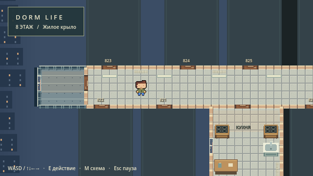
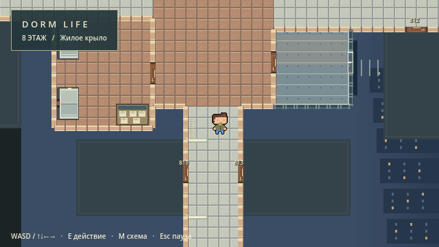
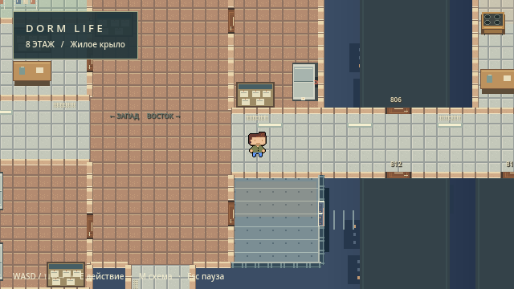
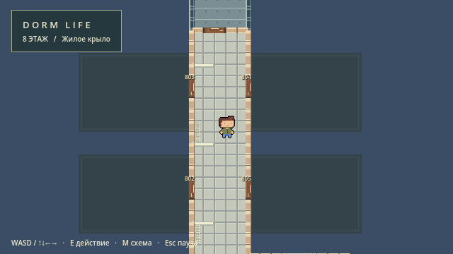

# Компактный блок 813 и радиаторы

Дата: 1 ноября 2026. Godot 4.3 stable official 77dcf97d8.

## Внесённые изменения

- `Scripts/Dorm/FloorManager.gd`: радиаторы больше не зависят от координат ламп. Для каждого участка коридора алгоритм ищет пару непрерывных стеновых сегментов, проверяет дверные проёмы и их подходы (запас 20 px), коллизии существующих объектов и видимые границы мебели. Если свободной стены нет, прибор не создаётся. Генерация выполняется после размещения всей мебели.
- Радиатор имеет общий центр спрайта и коллизии, размер 28×8 px у горизонтальной стены и 8×28 px у вертикальной. От внутренней поверхности стены оставлен зазор 1 px. Алгоритм применяется также к кухням. Четыре коридора: западный 8, южный 12, восточный 5, северный 21.
- `Scripts/Dorm/Block813.gd`: оболочка уменьшена с 800×608 до 600×456 px, площадь — на 43,75%. Мебель, перегородки, окна и двери уменьшены согласованно. Центральный коридор шириной 108 px, внутренние проёмы шириной 36 px. Персонаж и его коллизия сохранены. Частичные плитки обрезаются по границам помещений.
- Комната Б остаётся сверху, А — справа снизу, коридор — в центре снизу, туалет и душевая — слева. Сохранены 21 предмет, пять кроватей, пять столов и пять тумбочек. Уменьшенные предметы имеют коллизию своего размера.
- `Scripts/Dorm/Furniture.gd`: подушки и покрывала кроватей учитывают длинную ось предмета; горизонтальная кровать теперь рисуется с изголовьем сбоку.
- Камера рассчитывает zoom по фактической оболочке. Переходы на этаж и обратно используют прежний `DormTransition`.

## Проверки

- Headless: **2805 проверок, 0 ошибок**, `verify_compact813_headless.log`.
- Реальный OpenGL-рендер: **2883 проверки, 0 ошибок**, `verify_compact813_render.log`. Отдельный поток stderr: `verify_compact813_render_errors.log`.
- Проверены реальные коллизии, маршруты персонажа до всех пяти помещений, четыре внутренних проёма, отсутствие пересечений и принадлежность мебели своему помещению, пауза, движение, камера и два цикла входа/выхода.
- Проверены ориентация, привязка к стенам, соответствие рисунка коллизии и свободные подходы ко всем дверям для радиаторов; все четыре крыла покрыты.
- Обзор блока и отдельные кадры четырёх крыльев просмотрены визуально. Ручной игровой обход пользователем не выполнялся.

Команды из корня проекта (движок расположен в соседнем каталоге `Godot4.3`):

```powershell
& ../Godot4.3/Godot_v4.3-stable_win64_console.exe --headless --path . --editor --import --quit
& ../Godot4.3/Godot_v4.3-stable_win64_console.exe --headless --path . --script Scripts/Dorm/Verify.gd
& ../Godot4.3/Godot_v4.3-stable_win64_console.exe --path . --script Scripts/Dorm/Verify.gd
```

## Границы выполненного задания

Полученный запрос обрывается в начале пункта 3. Подробные требования к кроватям, сантехнике, мебели и окнам после этой точки не получены. В `references/план этажа(1).drawio` есть схема общего этажа, но нет отдельного чертежа интерьера 813. Поэтому выполнено уменьшение существующей планировки по доступному текстовому описанию; точное соответствие отсутствующему чертежу не заявляется. Дальнейшее размещение по чертежу требует самого референса и продолжения запроса.

Работа выполнена поверх существующей рабочей копии с незакоммиченным MVP блока 813; ранее внесённые изменения сохранены. Коммит, push и PR не выполнялись.

## Кадры






