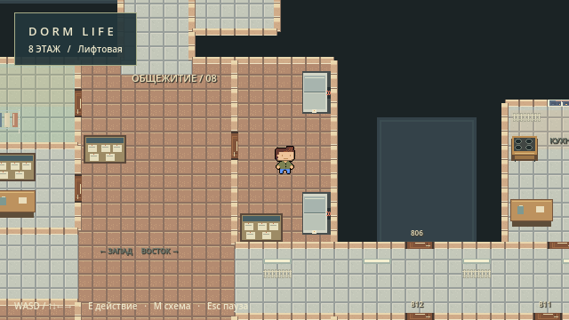
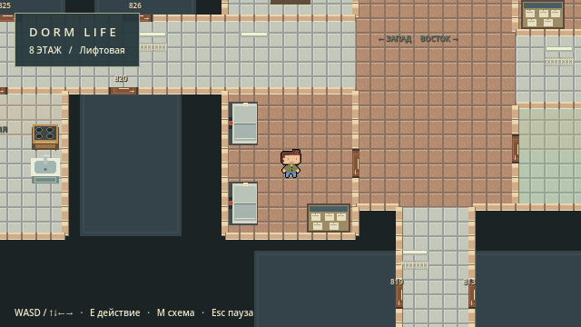
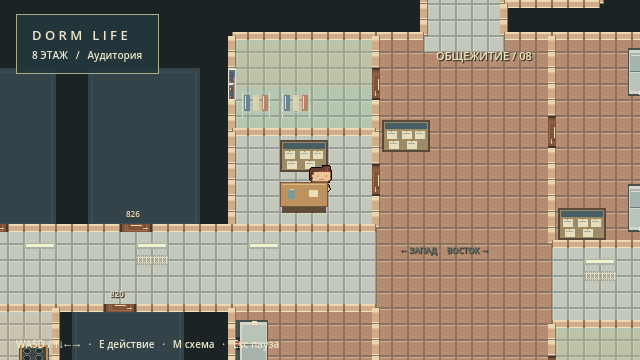
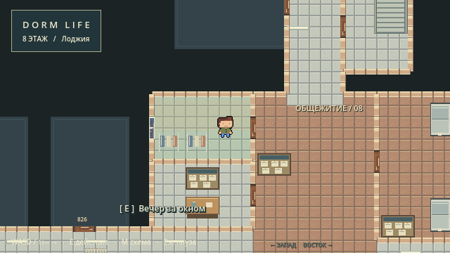
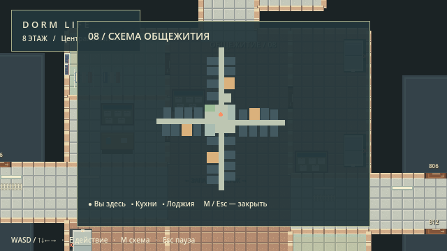

# Исправление ориентации этажа 08 — 1 ноября 2026

## Реализация

- `Data/Floors/floor08.json`: явные `window_side`, `elevator_side`, `elevator_count`, `block_number`; увеличен прямоугольник лифтовой 26.
- `Scripts/Dorm/FloorManager.gd`: обязательная сторона окна без запасного направления; общий генератор кабин с ориентированными спрайтами, коллизиями и точками E; номера из данных; устойчивый слой дверного полотна. Доски объявлений отнесены от кабин.
- `Scripts/Dorm/Verify.gd`: проверки направлений, кабин, размеров, дверей через E, номеров, обратного порядка JSON, A/B рендера дверей, снимки аудитории и схемы. Сохранены проверки движения, анимаций, доступа ко всем взаимодействиям и помещениям, стен, проёмов и UI.
- `docs/floor_layout.md`, `docs/assumptions.md`: актуальные правила данных и маршрут. Этот отчёт, `verify-orientation-*.log` и `preview_*.png` содержат результаты и реальные кадры.

## Окна

| Зона | Назначение | Сторона |
|---|---|---|
| 9 | Западный торцевой балкон | west |
| 6 | Восточный торцевой балкон | east |
| 22 | Северный торцевой балкон | north |
| 13 | Южный торцевой балкон | south |
| 28 | Лоджия | west |
| 4 | Выход к пожарной лестнице | east |

У балкона 4 вход находится слева, коридор — сверху, свободная внешняя граница справа; восточная сторона закреплена явно. Пожарная лестница как переход остаётся за пределами существующего MVP. Окна лежат вдоль стен, без собственной коллизии, с сохранённой сплошной внешней стеной. Поворот по оси, отступы от дверей и видимость игрока проверяются.

## Лифты и двери

| Лифтовая | Кабины, центры | Стена | Фронт | Точки E |
|---|---|---|---|---|
| 3 | (444,132), (444,268) | Восточная | На запад | (412,132), (412,268) |
| 26 | (52,404), (52,492) | Западная | На восток | (84,404), (84,492) |

Всего четыре кабины. Спрайт и коллизия каждой занимают 32×48 px; взаимодействие вынесено к доступному фронту. Доски объявлений не пересекают кабины и входы.

Лифтовая 26 расширена только на юг: `[32,368,144,128]` → `[32,368,144,160]`. Площадь 18 432 → 23 040 игровых px² (+25%). Коридор 8 находится севернее y=368; блок 37 начинается с y=544, после нового южного края y=528 остаётся зазор 16 px. Аудитория заканчивается на y=288. Пересечений с другими зонами нет. Схема M, пол и стены пересчитываются из того же прямоугольника.

Входы из холла: лифтовая 3 — западная стена `(352,200)`; лифтовая 26 — восточная `(176,448)`; аудитория 27 — восточная `(176,240)`. Все проёмы 32 px с единственной дверью, совпадающим коллайдером и запретом закрытия на игроке.

В исходном checkout двери уже создавались через `entrance` и правильное резервирование сегментов в `install_door()`: отсутствие дверей не воспроизвелось. Дополнительные двери не создавались. Для устойчивого отображения узких полотен их слой поднят до z=1; якорь и коллизия сохранены. A/B тест скрывает только полотно: у каждой из трёх дверей меняется 256 пикселей реального кадра, подтверждая фактическую видимость. E проверен при подходе из холла; физические sweep-тесты подтверждают блокировку закрытой и проход через открытую дверь.

## Нумерация

Север: 36→35→34→33 к торцу по западной стороне, затем 32→31 обратно по восточной. Предложенная таблица совпадает с геометрией; блок 36 находится через коридор напротив лестницы 29.

После севера выбран игровой маршрут по часовой стрелке: восток → юг → запад. В каждом крыле движение к торцу по одной стороне и возврат по другой. Это детерминированная игровая последовательность, исторические номера здания не заявляются. Число хранится непосредственно в зоне: перестановка JSON и будущие изменения координат не перенумеровывают блоки.

| ID блока | Номер |
|---|---|
| 36 | 800 |
| 35 | 801 |
| 34 | 802 |
| 33 | 803 |
| 32 | 804 |
| 31 | 805 |
| 51 | 806 |
| 52 | 807 |
| 53 | 808 |
| 57 | 809 |
| 56 | 810 |
| 55 | 811 |
| 54 | 812 |
| 38 | 813 |
| 39 | 814 |
| 40 | 815 |
| 41 | 816 |
| 43 | 817 |
| 42 | 818 |
| 37 | 819 |
| 44 | 820 |
| 45 | 821 |
| 46 | 822 |
| 47 | 823 |
| 48 | 824 |
| 49 | 825 |
| 50 | 826 |

Номер используется одной дверью, её подписью и текстом действия. 27 уникальных значений от 800 до 826 без пропусков. Генерация второго экземпляра сцены с обратным порядком всех зон даёт те же номера.

## Проверки

Godot 4.3 stable (`77dcf97d8`), Windows, графический рендер OpenGL Compatibility.

```text
Godot --headless --path . --editor --import --quit
Exit 0, ошибок импорта и скриптов нет

Godot --headless --path . --script res://Scripts/Dorm/Verify.gd
VERIFY_COMPLETE checks=1866 failures=0

Godot --path . --script res://Scripts/Dorm/Verify.gd
VERIFY_COMPLETE checks=1907 failures=0
```

Логи: [импорт](verify-orientation-import.log), [headless](verify-orientation-headless.log), [рендер](verify-orientation-render.log). Провалившихся проверок нет. `git diff --check` проходит. Генератор `build_dorm.py` не запускался.

Проверены настоящие кадры четырёх торцевых балконов, балкона 4, обеих лифтовых, аудитории, лоджии и схемы M. Дополнительно тест сравнивает кадры с видимым/скрытым игроком у окон, проверяет реальную доступность всех взаимодействий через физический поиск и вызов панели каждого лифта через E.







## Ограничения

Сохранены ограничения MVP: переходы на другие этажи и пожарную лестницу не реализованы, жилые блоки закрыты. Габариты — игровые, реальные обмеры не заявляются. Боковое изображение лифта использует существующую pixel-art текстуру с поворотом и масштабом; новые ресурсы и механики не добавлены. Автоматические проверки и визуальный просмотр подтверждают текущее состояние на Godot 4.3; длительный ручной игровой сеанс не проводился.
